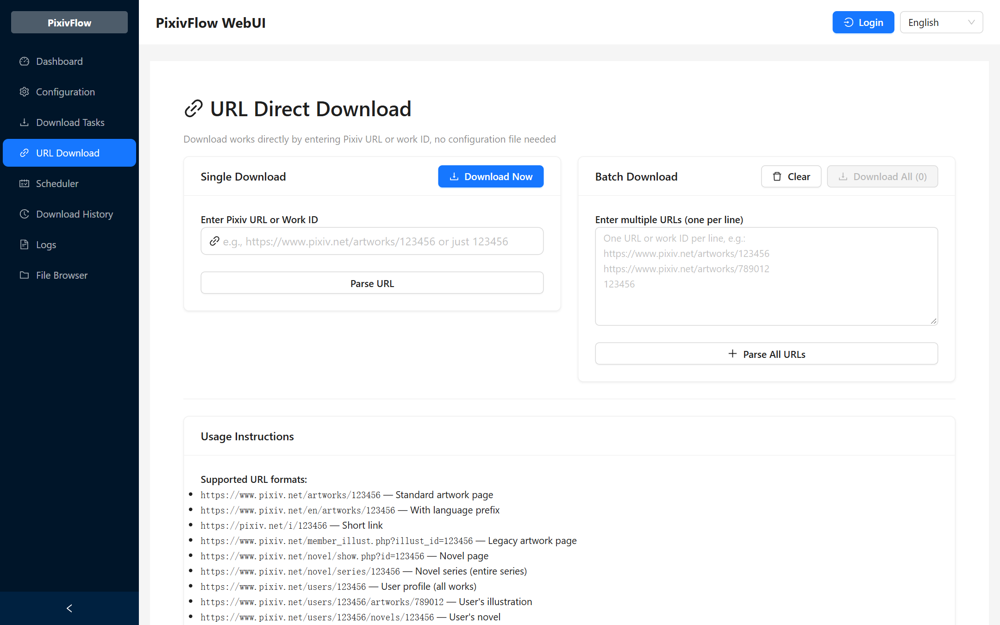
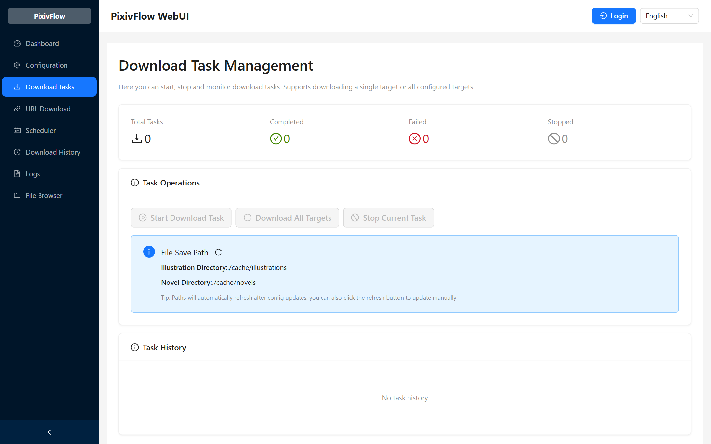
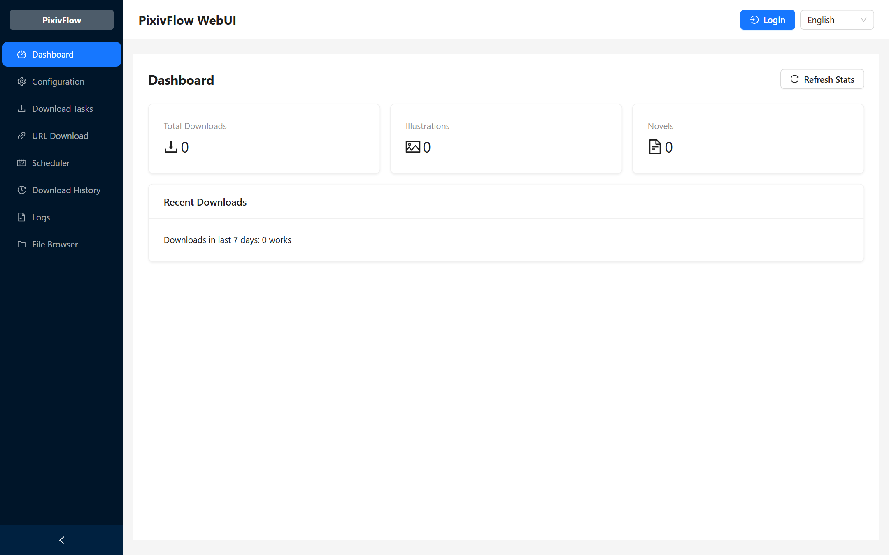

# PixivFlow

Language / 语言: [中文](README.md) · English


[](https://www.npmjs.com/package/pixivflow)
[](https://nodejs.org/)
[](LICENSE)
[](https://redtidev1918.github.io/PixivFlow/)

**Save Pixiv illustrations, manga, novels and animations to your own computer, collect works by tag or ranking, and run downloads on a schedule.**

Downloaded files stay on your computer or server. No extra account is required.

[Interface](#interface) · [What it does](#what-it-does) · [Choose how to install](#choose-how-to-install) · [Get started](#get-started) · [Batch downloads](#batch-downloads) · [Scheduled downloads](#scheduled-downloads) · [Common questions](#common-questions) · [Full documentation](https://redtidev1918.github.io/PixivFlow/)

## Interface

Run `pixivflow web` to open the browser interface, which covers most day-to-day work. The screenshots below are the real interface.

Paste a work URL to download it, or one URL per line to resolve a batch:



Start, stop and follow download tasks; the saved file paths are shown here too:



The dashboard summarises download counts and recent records:



## What it does

**Save a single work.** Paste a work, novel, novel series or artist profile URL. Every page of a multi-page illustration is saved; animations are converted to GIF; novels are saved as TXT with their inline images downloaded alongside.

**Collect works in bulk.** Filter illustrations or novels by tag, ranking, publication date and bookmark count, exclude AI-generated works, or limit novels by language. Works already in your download history are skipped, so a run may add fewer works than the limit you set.

**Run on a schedule.** Set the execution time with a cron expression and a time zone, or configure several independent schedules. Execution state is kept in a local database, so a restarted process continues from its ledger instead of starting over.

**Manage everything in the browser.** `pixivflow web` shows download records, task control, configuration and scheduler state. The scheduling centre reports per-target status and the terminal reason, such as an empty candidate pool or an already-downloaded work.

**Discover related tags.** `pixivflow topic resolve <topic>` expands a topic into related Pixiv tags. It uses tag and work metadata statistics only; no large language model is involved.

**Deliver files downstream.** After a download completes, files can be delivered to your own service over Webhook or HTTP Multipart, or passed to [TelePost](https://github.com/redtidev1918/TelePost) for submission to a Telegram review group. PixivFlow fetches, filters and downloads; TelePost handles submission, review and publishing.

## How it works

For everyday use there is a single path:

```text
Sign in to Pixiv → pick a work or set collection rules → download → saved locally
```

For ongoing automatic collection, filtering and delivery are added:

```text
Set filter rules → set a schedule → discover and rank candidates, skipping duplicates
→ download → optionally deliver downstream → review results in the interface
```

## Choose how to install

| How you use it | Who it suits | Notes |
| --- | --- | --- |
| Command line + browser interface (recommended start) | Anyone who wants to download or collect soon | Installed from npm; the browser interface is included in the package |
| Docker / always-on server | Keeping it running long term on a server | The repository ships `Dockerfile`, `Dockerfile.scheduler` and `docker-compose.yml`; build the image yourself following the [Docker guide](docs/DOCKER.md) (Chinese) |
| Desktop client | A standalone desktop application | Maintained in the separate [pixivflow-desktop](https://github.com/redtidev1918/pixivflow-desktop) repository; releases and completeness are tracked there |
| Android / Termux | Running it on a phone | Follow the [Termux guide](docs/TERMUX_INSTALL.md) (Chinese) |

The quick start below covers the command-line version, which also provides the browser interface. The frontend itself lives in the [WebUI repository](https://github.com/redtidev1918/pixivflow-webui).

## Get started

Four steps are enough to download a single work. Open PowerShell on Windows or a terminal on macOS / Linux, and copy each command in turn.

Before you start, check that:

- You have a Pixiv account and your network can reach Pixiv (some networks need a proxy).
- [Node.js](https://nodejs.org/) 22.13 or newer is installed; npm comes with it and must be version 9 or newer.
- Chrome or Chromium is installed for the interactive login.

### 1. Install

After installing Node.js, reopen your terminal. Check the versions with the first two commands, then install PixivFlow:

```bash
node -v
npm -v
npm install -g pixivflow
pixivflow --help
```

If `pixivflow --help` displays the command help, installation succeeded.

### 2. Sign in to Pixiv

```bash
pixivflow login
```

The command opens Chrome or Chromium on your machine; sign in to your Pixiv account when prompted. Credentials are then saved locally and reused for downloads.

> **Warning: the login output contains credentials.** The login command prints tokens such as the access token and refresh token to your terminal. Never paste terminal output, logs or screenshots that contain them into an issue, a chat group or any public site. Remove sensitive information before asking for help.

Server login and importing an existing token are covered in the [login guide](docs/en/LOGIN.md).

### 3. Download your first work

Open the work you want to save on Pixiv and copy its URL from the browser address bar. Replace the example URL below, keeping the double quotes:

```bash
pixivflow download --url "https://www.pixiv.net/artworks/123456789"
```

Novel, novel series and artist profile URLs work the same way:

```bash
pixivflow download --url "https://www.pixiv.net/novel/show.php?id=12345678"
```

See the [usage guide](docs/en/USAGE.md) for the URL formats `--url` accepts.

### 4. Find your files

```bash
pixivflow dirs
```

The output lists the actual paths of your configuration file and download directories; open them in your file manager. Locations differ between installation methods, so use the paths this command prints.

Run `pixivflow status` to see download counts and recent records.

## Use it in your browser

Run:

```bash
pixivflow web
```

Open the address shown in your terminal, normally [http://localhost:3000](http://localhost:3000). The npm package includes the browser interface.

You can inspect download records, configuration and task results there. Keep the command running while you use the interface and press `Ctrl+C` to stop it; if the port is taken, choose another one:

```bash
pixivflow web --port 8080
```

On a server, configure access credentials as described in the [Docker guide](docs/DOCKER.md) (Chinese) before exposing the interface; it listens on the local address by default.

## Batch downloads

To collect several works at once, set conditions on tags, rankings, publication dates and bookmark counts. Run the wizard the first time:

```bash
pixivflow setup
```

Then start collecting:

```bash
pixivflow download
```

Previously downloaded works are skipped, so you may get fewer new works than the limit you set.

<details>
<summary>Set collection rules manually: illustration and novel examples</summary>

If you already have a configuration, back it up and edit it:

```bash
pixivflow config backup
pixivflow config edit
```

Replace `targets` in your active configuration with the array below, keeping your credentials and other fields. This fragment downloads up to 10 illustrations and 5 novels per run:

```json
{
  "targets": [
    { "type": "illustration", "tag": "風景", "limit": 10 },
    { "type": "novel", "tag": "ファンタジー", "limit": 5 }
  ]
}
```

Save, validate, then download:

```bash
pixivflow config validate
pixivflow download
```

</details>

Common filter fields:

| Setting | Meaning |
| --- | --- |
| `type` | `illustration` for illustrations / manga; `novel` for novels |
| `tag` | A Pixiv search tag; try a tag already shown on a work page |
| `limit` | Maximum number of works to download per run |
| `mode` | `search` (by tag), `ranking` (by ranking) or `topic` (resolve a topic into tags) |
| `minBookmarks` | Minimum bookmark count, for filtering popular works |
| `startDate` / `endDate` | Publication date range, in `YYYY-MM-DD` format |
| `excludeAI` | Whether to exclude AI-generated works |

See the [batch download walkthrough](docs/en/QUICKSTART.md#download-by-tag) for more examples and the [configuration reference](docs/en/CONFIG.md) for all filters.

## Scheduled downloads

Make sure batch downloads work first, then set up a schedule. You can do it in the `pixivflow setup` wizard or by editing the configuration.

<details>
<summary>Set a time manually: every day at 03:00 in Asia/Shanghai</summary>

Set `scheduler` in your active configuration:

```json
{
  "scheduler": {
    "enabled": true,
    "cron": "0 3 * * *",
    "timezone": "Asia/Shanghai"
  }
}
```

Merge this fragment into your existing configuration, save and validate it, then start:

```bash
pixivflow config validate
pixivflow scheduler
```

To run several times a day, or to give different targets different times, use the `schedules` array to configure independent schedules (when `schedules` is present, the older `scheduler.cron` is ignored). Field details are in the [configuration reference](docs/en/CONFIG.md).

</details>

Scheduled downloads need this command to keep running; nothing runs while the computer is shut down or asleep. By default a process that starts after downtime runs the missed execution once — see the [configuration reference](docs/en/CONFIG.md).

To keep it running on a server, see the [Docker guide](docs/DOCKER.md) (Chinese).

## Where files are stored

- Local storage uses `persistent` mode by default: downloaded files stay on disk.
- With `cache` mode and a delivery target configured, files can be removed once the receiving service confirms success; files that fail to deliver are kept.
- Run `pixivflow dirs` to see the configuration, database and download directories actually in use.

See the [configuration reference](docs/en/CONFIG.md) for storage locations, organisation and cleanup policy.

## Common questions

| Problem | What to try |
| --- | --- |
| `pixivflow` command not found | Reopen your terminal, confirm the global installation succeeded, and check that the npm global executable directory is in `PATH` |
| Login fails or credentials have expired | Run `pixivflow login` again; for servers see the [login guide](docs/en/LOGIN.md) |
| Cannot connect to Pixiv | Run `pixivflow health`; if you need a proxy, see the [configuration reference](docs/en/CONFIG.md) |
| No works were downloaded | Check the tag, date and bookmark filters; matching works may already be in your history, or every candidate may have been filtered out |
| Cannot find downloaded files | Run `pixivflow dirs` for the actual locations |
| Does my computer have to stay on? | Yes. `pixivflow scheduler` needs the process running; nothing runs while the machine is off or asleep, and missed executions can be caught up on the next start. For 24/7 operation use a server or Docker |
| Missing dependencies for animations | Converting ugoira to GIF needs `python3` and `ffmpeg`; if the conversion fails the original frames are kept. An image built from this repository includes both — see the [Docker guide](docs/DOCKER.md) (Chinese) |
| A scheduled task did not run | Keep the process running, set `scheduler.enabled` to `true`, and check the cron expression and time zone |
| How is the desktop client different from the browser interface? | The browser interface ships in this repository's npm package via `pixivflow web`; the desktop client is a separate project, see [pixivflow-desktop](https://github.com/redtidev1918/pixivflow-desktop) |
| Can I run it on a server? | Yes. See the [Docker guide](docs/DOCKER.md) (Chinese); make sure the process is not reclaimed by the system |

For further help, open an [issue](https://github.com/redtidev1918/PixivFlow/issues) with reproduction steps, version, operating system and sanitized error output. Report security vulnerabilities as described in the [security policy](SECURITY.en.md).

<details>
<summary>Command reference</summary>

| What you want to do | Command |
| --- | --- |
| Show help | `pixivflow --help` |
| Sign in | `pixivflow login` |
| Download a link | `pixivflow download --url "<work URL>"` |
| Download configured targets | `pixivflow download` |
| Run the initial setup wizard | `pixivflow setup` |
| Edit / check configuration | `pixivflow config edit` / `pixivflow config validate` |
| Find file locations | `pixivflow dirs` |
| View download statistics | `pixivflow status` |
| Check environment and connectivity | `pixivflow health` |
| Open the browser interface | `pixivflow web` |
| Start scheduled downloads | `pixivflow scheduler` |
| Resolve a topic into tags | `pixivflow topic resolve "<topic>"` |
| Troubleshoot delivery | `pixivflow outbox` / `pixivflow delivery` |

</details>

## Documentation

| What you want to learn | Documentation |
| --- | --- |
| Complete setup walkthrough | [Quick start](docs/en/QUICKSTART.md) |
| Packages and download options | [Download page](docs/en/download.md) |
| Login and credential maintenance | [Login guide](docs/en/LOGIN.md) |
| Download modes and settings | [Usage guide](docs/en/USAGE.md) · [Configuration reference](docs/en/CONFIG.md) |
| Server / container deployment | [Docker guide](docs/DOCKER.md) (Chinese) · [Termux guide](docs/TERMUX_INSTALL.md) (Chinese) |
| Send works to another service | [External gateway guide](docs/GATEWAY.md) (Chinese) |
| Configure operational notifications | [Apprise notifications](docs/APPRISE.md) (Chinese) |
| Upgrade from an older version | [Migration guide](docs/MIGRATION.md) (Chinese) · [Changelog](CHANGELOG.md) |
| Architecture and troubleshooting | [Architecture](docs/ARCHITECTURE.md) (Chinese) · [Slot outcomes](docs/SLOT_OUTCOME.md) (Chinese) |
| npm release process | [Release process](docs/RELEASING.md) (Chinese) |

Build from source:

```bash
git clone https://github.com/redtidev1918/PixivFlow.git
cd PixivFlow
npm install
npm run build
node dist/index.js --help
```

## Related projects

- [TelePost](https://github.com/redtidev1918/TelePost) — Telegram submission, review and publishing
- [pixivflow-telepost-deploy](https://github.com/redtidev1918/pixivflow-telepost-deploy) — deployment kit that wires both projects together
- [pixivflow-webui](https://github.com/redtidev1918/pixivflow-webui) — browser interface frontend
- [pixivflow-desktop](https://github.com/redtidev1918/pixivflow-desktop) — desktop client

Responsibilities stay separate: PixivFlow handles Pixiv authentication, candidate discovery and downloading; TelePost handles submission and review on the Telegram side; the deployment kit connects the two.

## Acknowledgments

- [gallery-dl](https://github.com/mikf/gallery-dl) — reference for ugoira and novel text handling
- [pixiv-app-api](https://github.com/akameco/pixiv-app-api) · [pixiv-api](https://github.com/azuline/pixiv-api) — App API endpoint semantics
- [get-pixivpy-token](https://github.com/eggplants/get-pixivpy-token) — OAuth login flow reference
- [pixiv-token-getter](https://github.com/redtidev1918/pixiv-token-getter) — login library

Not affiliated with Pixiv Inc. Full statement: [docs/ACKNOWLEDGMENTS.md](docs/ACKNOWLEDGMENTS.md).

## License

[MIT](LICENSE)
