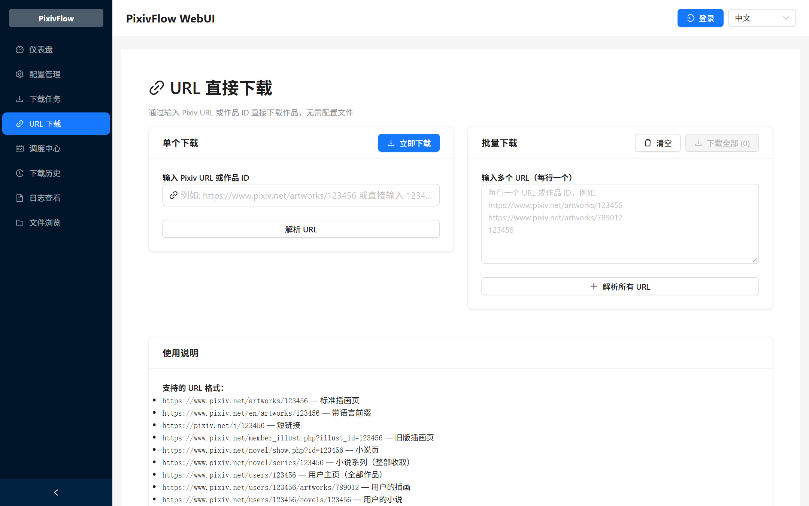
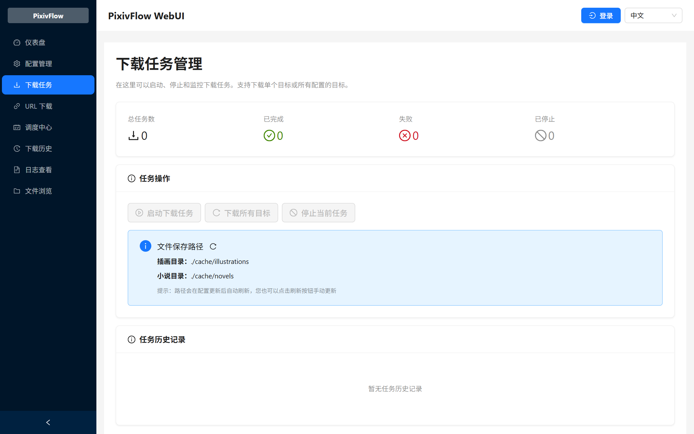
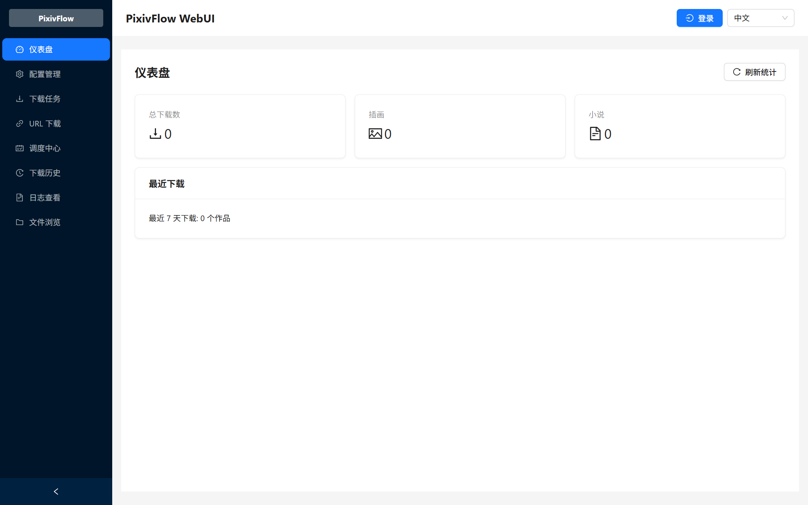

# WebUI 使用指南

WebUI 是 PixivFlow 的浏览器界面，属于可选入口。命令行已经可以完成全部下载与调度工作，界面用于更方便地查看状态、管理下载任务和临时下载链接。

前端源码在 [pixivflow-webui](https://github.com/redtidev1918/pixivflow-webui) 仓库维护；npm 发布包内已经包含构建好的静态文件，不需要单独安装前端。

## 启动

```bash
pixivflow web
```

默认监听 `http://localhost:3000`，地址会显示在终端。界面运行期间保持命令运行，按 `Ctrl+C` 停止。

| 需要 | 命令 |
| --- | --- |
| 换一个端口 | `pixivflow web --port 8080` |
| 指定配置文件 | `pixivflow web --config "/path/to/my config.json"` |
| 绑定其他网卡地址 | `pixivflow web --host 0.0.0.0`（先按下面的说明配置访问凭据） |
| 使用自定义静态包 | `pixivflow web --static-path ./webui-frontend/dist` |

配置路径优先级为 `--config` > `PIXIV_DOWNLOADER_CONFIG` > 默认配置。相对路径按启动命令的工作目录解析；路径包含空格时加引号。指定文件不存在或 JSON 无效时会报错，不会静默切换配置。WebUI、API、下载任务及调度模块共用已选定的文件；环境变量也可用于其他 CLI 命令。

## 界面功能

| 页面 | 可以做什么 |
| --- | --- |
| 仪表盘 | 下载数量统计与最近记录 |
| 下载任务 | 启动、停止和查看下载任务，显示作品保存目录 |
| URL 下载 | 粘贴单个或批量 URL 直接下载，不需要修改配置 |
| 调度中心 | 查看最近执行的逐目标状态与终态原因；配置恢复代理后可对允许恢复的目标重试 |
| 下载历史 | 查看历史任务记录 |
| 配置管理 | 查看和编辑配置，密钥字段由服务端脱敏 |
| 日志查看 | 查看运行日志 |
| 文件浏览 | 浏览已下载的文件 |

调度中心区分尚未配置计划、计划未启用及已配置但暂无执行记录；这些是正常空状态，不需要先登录 Pixiv。配置、API 或数据库真实异常仍显示错误。

恢复操作由服务端代理转发到既有调度恢复入口。服务端需设置 `SCHEDULER_TRIGGER_URL`
（或 `PIXIVFLOW_TRIGGER_BASE_URL`）和 `SCHEDULER_TRIGGER_TOKEN`；缺少配置时返回 503，
不影响只读查询。触发凭据不进入浏览器；已成功或仍在执行的目标不允许恢复。

## 界面截图

URL 直接下载：输入作品链接单独下载，也可以每行一个链接批量解析。



下载任务管理：启动、停止和查看下载任务，并显示插画与小说的保存目录。



仪表盘：汇总下载数量与最近记录。



## 网络访问与安全

- 默认只监听 `localhost`，只有本机浏览器可以访问。
- 需要从其他设备访问时，先设置 `WEBUI_USERNAME` 和 `WEBUI_PASSWORD` 开启 HTTP Basic Auth：

  ```bash
  WEBUI_USERNAME=admin WEBUI_PASSWORD='设置一个强口令' pixivflow web --host 0.0.0.0
  ```

- 绑定非本机地址却没有设置凭据时，服务会拒绝启动（fail-closed）。只有显式设置 `WEBUI_ALLOW_PUBLIC_NO_AUTH=true` 才会在无认证状态下运行，并显示安全警告。此时同一网络上的任何人都能读取配置、下载文件和触发下载，不要在不可信网络中使用。
- 需要 HTTPS 时同时设置 `WEBUI_TLS_CERT` 和 `WEBUI_TLS_KEY`。
- 配置中的密钥字段（例如 `clientSecret`、`refreshToken`）由服务端脱敏后再返回浏览器。

## 与其他入口的关系

WebUI 与命令行共用同一份配置文件和同一个本地数据库，界面中的下载任务和 `pixivflow download` 使用同一套下载与调度逻辑，不会产生两份记录。

界面依赖 `pixivflow web` 进程运行；需要在服务器或 NAS 上长期运行，参考 [Docker 部署指南](DOCKER.md)。网络环境与代理配置见 [配置参考](CONFIG.md)。

## 前端开发与更多文档

本仓库只包含前端构建产物 `webui-frontend/dist`，前端源码、组件结构和构建方式都在 [pixivflow-webui](https://github.com/redtidev1918/pixivflow-webui)：

- [WebUI 文档站](https://redtidev1918.github.io/pixivflow-webui/)
- [开发指南](https://github.com/redtidev1918/pixivflow-webui/blob/master/docs/DEVELOPMENT_GUIDE.md) · [组件指南](https://github.com/redtidev1918/pixivflow-webui/blob/master/docs/COMPONENT_GUIDE.md) · [构建选项](https://github.com/redtidev1918/pixivflow-webui/blob/master/docs/BUILD_OPTIONS.md)
- 后端 REST 接口与 Socket.IO 事件见 [WebUI API](API.md)
