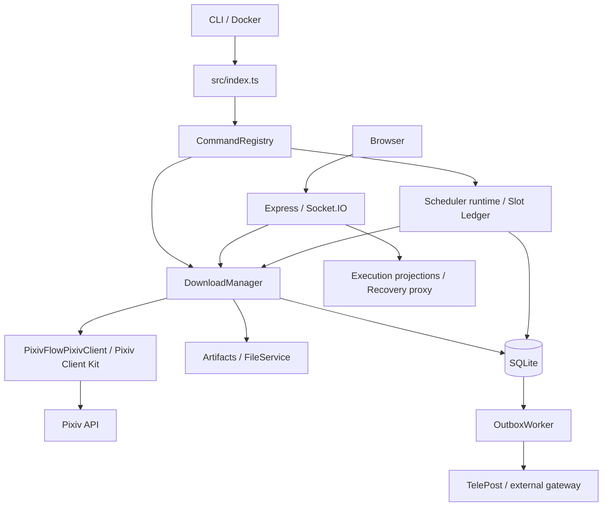

::: v-pre

# PixivFlow architecture

Language: [中文](../ARCHITECTURE.md) · English

This guide helps contributors locate code, follow data and extend the system. Day-to-day commands are in [Usage](USAGE.md); HTTP and Socket.IO contracts are in [API](API.md). Cross-repository authority lives in the deploy repository's [operating contract](https://github.com/redtidev1918/pixivflow-telepost-deploy/blob/master/AGENTS.md), [platform architecture](https://github.com/redtidev1918/pixivflow-telepost-deploy/blob/master/docs/architecture/ecosystem-platform.md) and [production contract](https://github.com/redtidev1918/pixivflow-telepost-deploy/blob/master/CONTRACT.md).

## Responsibilities and code map

PixivFlow owns Pixiv authentication, discovery, parsing, filtering/ranking, artifact materialization, execution, slots, outbox and recovery. TelePost owns submissions, review, publication and Telegram credentials. TelePress owns preview/publishing. WebUI owns presentation and consumes existing APIs; it does not own a second scheduler or database.



| Location | Responsibility |
| --- | --- |
| `src/index.ts`, `src/cli/` | Argument parsing, config bootstrap and command dispatch |
| `src/commands/` | Commands, aliases, metadata, validation and orchestration |
| `src/config/` | Types/defaults, path selection, environment overrides, validation, placeholders |
| `src/di/` | Optional small instance/factory/singleton container; main CLI assembly is explicit |
| `src/download/` | Planner, pipeline, executor, target handlers, downloaders, recovery, reports and files |
| `src/domain/media/` | MediaAsset, Artifact and materialization/cover policies |
| `src/scheduler/` | Occurrences, slots, resource admission, runtime, lifecycle and recovery |
| `src/storage/` | Database facade, migrations, repositories and driver interface |
| `src/pixiv-client/` | Product-specific target mapping, pagination/search semantics and SQLite rate-limit state |
| `packages/pixiv-client/` | Reusable protocol/HTTP/429 kit; [Pixiv Client Kit](PIXIV_CLIENT_KIT.md) |
| `src/auth/`, `src/terminal-login/`, login adapters | OAuth/token maintenance and browser login |
| `src/delivery/`, `src/notification/` | Delivery intents, ACK parsing, outbox, routing and notification policy |
| `src/webui/` | Server, middleware, handlers, task manager, static hosting and WebSocket channels |
| `src/interfaces/`, `src/utils/`, `src/logger.ts` | Ports, shared utilities, errors, tokens and structured logs |

## CLI execution

`CommandRegistry` maps primary names and aliases to commands, rejects alias collisions, suggests close names and groups help by metadata. Do not rely on a fixed command count; `src/commands/index.ts` is authoritative.

```text
ArgumentParser.parse(argv)
  → HelpRequest / VersionRequest: print without config bootstrap
  → resolve --config > PIXIV_DOWNLOADER_CONFIG > default
  → publish the active absolute path
  → refresh preExecute hook when applicable
  → loadConfig and build CommandContext
  → validate(args), execute(context, args), render CommandResult
```

Login and token-optional commands may load config without authentication validation. Token-optional lookup uses the canonical command name, so `web`, `webui` and `w` behave consistently. A long-running command keeps the process alive and must close resources on signals. Without a command, `scheduler.enabled` selects scheduler versus one download run.

Commands returning their user output in `CommandResult` declare `metadata.rendersResult: true`; commands printing their own output omit it. `--json` renders `data`, falling back to `message`. Failure must include a visible reason and structured `{command, stage, reason, retryable, error}` logging. `serializeLogValue` preserves Error message, stack, cause and enumerable contract fields. Commands already printing failure details use `printsOwnErrors: true` to avoid duplicates.

## Download pipeline and media

`DownloadManager.runAllTargets()` dispatches configured targets to illustration or novel handlers, preserving per-target results. Existing target search/topic/ranking modules are reused for acquisition and fallback; there is no separate recovery search engine.

- Direct work IDs check duplicate history before downloading. Artist targets use artist acquisition.
- Tag search expands bounded candidate scans according to ranking/limit settings. Ranking with a filter tag uses a dated candidate window and local popularity ordering; ordinary ranking uses `RankingService` fallback. Dynamic dates such as `YESTERDAY` resolve for each execution.
- `DownloadPlanner` filters bookmarks/dates, deduplicates IDs across sources, queries downloaded IDs in bulk, then applies limits/randomization. Topic candidates remain bounded and ordered for sequential replacement before a work lock.
- `DownloadPipeline` delegates bounded workers to `DownloadExecutor`. `ErrorRecoveryStrategy` chooses retry, backoff, skip or failure. Defaults include download concurrency 3, maximum retries 3 and retry delay 2000 ms; see [Configuration](CONFIG.md).
- Illustration processing obtains details and page URLs, downloads media with timeouts, sanitizes filenames, applies organization policy, writes metadata and updates download records. Existing files without corresponding history can be reconciled instead of fetched again.

Keep `Work`, remote `MediaAsset`, materialized `Artifact` and platform `DeliveryVariant` distinct. A media reference does not imply a local file exists. The resolve/materialize split supports optional materialization, while existing file-based delivery remains compatible. Canonical delivery uses `Artifact[]`; do not reintroduce the removed `DownloadedArtifact.files[]` model.

### Novel covers

URL normalization removes invalid/default-placeholder URLs and scaled URL segments. Classification happens after fetching bytes: image headers identify the 640×900 Pixiv-generated design canvas; ordinary custom canvases remain eligible. `custom` delivers a cover, `pixiv_generated` skips it, `unknown` and `probe_failed` default to skip with diagnostics. Explicit `download.novelCover.unknown` / `probeFailed: "keep"` selects availability instead. Unknown content and a failed network probe remain separate outcomes; URL shape alone cannot reliably distinguish generated and author covers.

## Scheduling and durable execution

The legacy `Scheduler` wraps node-cron, validates cron/timezone, guards overlap, limits frequency/execution count/consecutive failures, records execution outcomes and stops cleanly. A recorded timeout does not forcibly interrupt every awaited operation. Token maintenance runs alongside scheduler lifecycle. Legacy execution counters are not a substitute for durable cell outcomes.

The durable runtime converges all trigger sources through a canonical occurrence and Slot Ledger:

| Concept | Contract |
| --- | --- |
| Occurrence identity | `OccurrenceResolver`: schedule ID + cron + schedule timezone → `<scheduleId>@<occurrenceStamp>` |
| Membership | Freeze target IDs and cells when the occurrence is first created; reload affects future occurrences |
| Work binding | Persist `work_id` before artifact/delivery effects; crash-resume and retries use that work |
| Cell states | `pending → selected → artifact_ready → delivery_pending → submitted`; terminal alternatives `no_candidate`, `duplicate`, `failed` |
| Aggregate | All confirmed → success; confirmed plus exhausted targets → partial; none confirmed and exhausted → failed |
| Candidate fallback | Before work binding; durable bounded stage and scan bounds; no hidden replacement after binding |
| Slot lease | CAS owner/expiry prevents concurrent execution of one occurrence |
| Outbox | Replay only the existing side effect; never re-enter candidate selection |
| Terminal reasons | Persist normalized code/message and relay business reasons without raw SQL/paths/tokens/stacks |

Required targets first exhaust infrastructure retry and bounded candidate fallback. Submitted siblings never rerun. Recovery exhaustion is not a root cause: preserve `duplicate_exhausted`, `no_candidate`, `filter_exhausted` or the actual infrastructure/delivery reason. Every notifying production occurrence has one logical durable terminal summary (`notification:<slot>:summary`), including success; reconciliation repairs terminal slots missing a summary before outbox pumping.

External clocks only POST idempotent triggers. External mode does not execute schedules just because the daemon starts and never backfills expired occurrences. Schedule timezones, not the host timezone, define occurrences. CLI ad-hoc execution and manual refetch are distinct from canonical scheduled occurrences.

### Resource admission, manual execution and idle shutdown

`ResourceAdmission` is the single FIFO admission mechanism. The resource key is `pixiv-account:<internal accountId>`; capacity comes from `schedulerRuntime.resourceGovernance.pixivAccounts[accountId].maxConcurrency` (default 1). Global `queueLimit` bounds waiting work, not per-account capacity. Schedule, fallback, manual refetch and normal/relaxed recovery all participate. Independent resources can run concurrently.

Manual refetch persists a request UUID-derived manual slot, cell, work binding, delivery and terminal callback. Accepted is not terminal. Resume the same request/work/intent after crashes. Find and deliver replacement B successfully before CAS promotion and superseding A. Outcomes use `refetchOutcomeUrl`, not schedule summaries.

Target recovery uses the existing authenticated `POST /internal/targets/:id/recover` dispatcher with `retryMode: normal|relaxed`; browser clients cannot submit raw policy overrides. Relaxed presets only widen bounded soft acquisition limits. Hard content/type/topic/delivery/integrity constraints stay fixed. Recover failed targets only; record the mode on the occurrence, preserve successful siblings and future global config.

Idle shutdown requires no active durable slots (manual included), no processing/pending/retry-wait outbox work, no in-process executions and no resource waiters. Dead rows do not block shutdown. Maximum lifetime closes gracefully without terminalizing unfinished work; the next wake resumes durable rows. The current single-process topology uses in-process admission; distributed leases require evidence of actual multi-process resource sharing.

## Delivery, acknowledgments and audit

`deliveries` records confirmed route/work delivery; pending intent alone does not prove delivery. The outbox owns at-least-once effects with leases, bounded exponential retries and receiver idempotency keys. Receiver business ACKs decide outcomes: HTTP 2xx with terminal remote failure is failed, and deterministic invalid/rejected/conflicting ACKs dead-letter immediately. Readiness failures defer without consuming an attempt; `/live` is not `/ready`.

For fan-out, each route has an independent intent/outbox row. Selection deduplication considers all required routes; only all-confirmed counts as a duplicate across routes. Retrying owed routes never resends confirmed ones. Routing remains centralized in `targetRoutes.ts`/`gatewayRoutes.ts`, and notification policy preserves the consolidated occurrence result.

`Content` freezes ordered text/image/file/video/album units in the outbox. `planDelivery` is the sole capability downgrade point: flatten unsupported albums, report unsupported/dropped media and tighten numeric limits. The authoritative flat fields are `album`, `albumMin`, `albumMax` in `TargetCapabilities`. `httpMultipart` uses receiver ACKs and automatically adds `idempotency_key` unless opted out. Templates prefer `{{workId}}` / `work_id`; `pixivId` is a deprecated alias. Asset IDs are opaque, with source namespace controlled by `download.assetNamespace`.

`webhook` sends platform-neutral JSON using reference files or bounded base64 and optional HMAC. Platform protocol/login/QR/session state belongs to external gateways. `telegram` direct delivery is deprecated: do not build new capabilities around it. See [Gateway](GATEWAY.md).

`delivery_events` is append-only and records claims, delivered/dead rows, readiness deferrals, scheduled retries, duplicates, execution summaries and audited replay/cancellation (`actor=cli`). Correlation/execution IDs connect the timeline. URL userinfo/query, headers and credentials are redacted. Event retention remains a separate policy concern.

```bash
pixivflow runs list --limit 20
pixivflow runs show <executionId>
pixivflow outbox inspect <id>
pixivflow outbox retry <id>
pixivflow outbox retry --dead
pixivflow outbox cancel <id>
pixivflow --version
```

## Storage

`Database` uses `SqliteDriver` and Node's built-in `node:sqlite` (Node 22.13.0+), without native module compilation. It creates parent directories, enables WAL/NORMAL and a bounded configurable cache, applies a 5000 ms busy timeout and the existing foreign-key policy, and runs idempotent schema migrations.

| Tables | Facts stored |
| --- | --- |
| `tokens` | Access-token cache and refresh-token backup |
| `downloads` | Downloaded work/type/path history; unique `(pixiv_id,type,file_path)` |
| `execution_log`, `scheduler_executions` | Target/legacy scheduler execution history |
| `config_history`, `task_history` | Config snapshots and WebUI download task history |
| `schedule_slots`, `schedule_slot_items` | Occurrences, frozen membership, work binding, cell status, fallback stage, terminal reasons |
| `deliveries`, `outbox`, `delivery_events` | Confirmed route results, durable effects and audit timeline |
| `gateway_connections` | Redacted endpoint pointers and cached gateway connection projection, not credentials |

Repositories expose domain queries through the facade. Deduplication happens both at planning and confirmed delivery boundaries. File normalization updates paths after moves/renames. Legacy incomplete download APIs use execution history; do not confuse them with durable schedule recovery.

## WebUI server and config

`WebUIServer` assembles middleware → API routes → static SPA serving (excluding `/api`) → error handler → HTTP/optional HTTPS server → authenticated Socket.IO. Basic Auth is shared by static content, APIs and sockets; public binding without credentials fails closed. Health probes remain available. Never bundle secrets in frontend assets.

Ports resolve options → environment → default 3000. `WebUICommand` supports host, static path and config path. Busy ports fail unless `PIXIV_WEBUI_AUTO_PORT=true` explicitly enables another available port. Static lookup considers command/environment paths, source/install locations and bundled frontend files; source builds can build a missing dist. API-only startup can return API information at `/`.

Startup validates the selected config before accepting requests, publishes it for all consumers and initializes the database. REST handlers reuse the same path and close connections after operations. `DownloadTaskManager` permits one active task in the WebUI process, persists `task_history`, bounds task logs and emits updates. Socket.IO provides `logs` and `download`; REST status remains the polling/hydration fallback.

`GET /api/scheduler` returns a read-only slot/cell projection and additive `scheduler: {enabled, configuredCount}`. Empty slots are a valid response, including before Pixiv login. No configured plan, disabled plans and configured plans with no executions have distinct UI states. Real config/database failures stay errors. Older backends lacking summary metadata show a generic no-records state. Recovery writes only proxy to the existing dispatcher; no new execution state lives in WebUI.

Config loading order:

1. Select and publish the path (`--config` > environment > implicit default); subsequent consumers use the published path.
2. Missing explicit path: fail. Missing implicit default: discover/create a default.
3. Parse JSON; apply field environment overrides and proxy environment adjustment.
4. Repair obsolete storage paths when needed, then fill defaults; relative storage paths use the config directory.
5. Set logging, synchronize token storage and validate when the command requires it.
6. Resolve dynamic placeholders for the execution.

Field precedence is environment > JSON > built-in default; `--config` chooses a file, not a competing set of JSON values. Relevant environment variables include `PIXIV_DOWNLOADER_CONFIG`, `PIXIV_REFRESH_TOKEN`, client ID/secret, `PIXIV_*_DIR`, `PIXIV_DATABASE_PATH`, `PIXIV_LOG_LEVEL`, `PIXIV_SCHEDULER_ENABLED`, proxy variables and WebUI `PORT`/`HOST`/`STATIC_PATH`. See [Configuration](CONFIG.md).

## Authentication and extension

Refresh tokens are long-lived credentials; access tokens expire. Login selects pixiv-token-getter, then Puppeteer/PKCE, then Python gppt. Runtime auth reuses cached tokens and refreshes through the OAuth client/kit; authentication failures differ from retryable network/rate-limit failures. Rotated refresh tokens are synchronized to config, database token storage and the unified token file/backup. Valid config tokens take precedence over fallback storage. Never publish credentials in code, docs or logs.

To add a command, extend `BaseCommand`, register it, declare rendering/long-running metadata correctly, and mark token-optional commands in CLI bootstrap when appropriate. To add an endpoint, use the domain handler and route modules, existing error codes, connection lifecycle and established path validation. Extend repository/facade/port interfaces together for storage changes. Do not introduce alternate business state or recovery logic in UI code.

Validate with focused regressions, `npx jest --silent --runInBand`, typecheck and required CI/package checks. Production behavior changes require test → PR → merge → release/artifact → deploy pin → runtime verification. Tests alone do not prove production rollout. Update stable architecture and dynamic deploy current-state documentation according to their ownership.

Related: [API](API.md), [Configuration](CONFIG.md), [Login](LOGIN.md), [Frontend development guide](https://github.com/redtidev1918/pixivflow-webui/blob/master/docs/DEVELOPMENT_GUIDE.md).

:::
